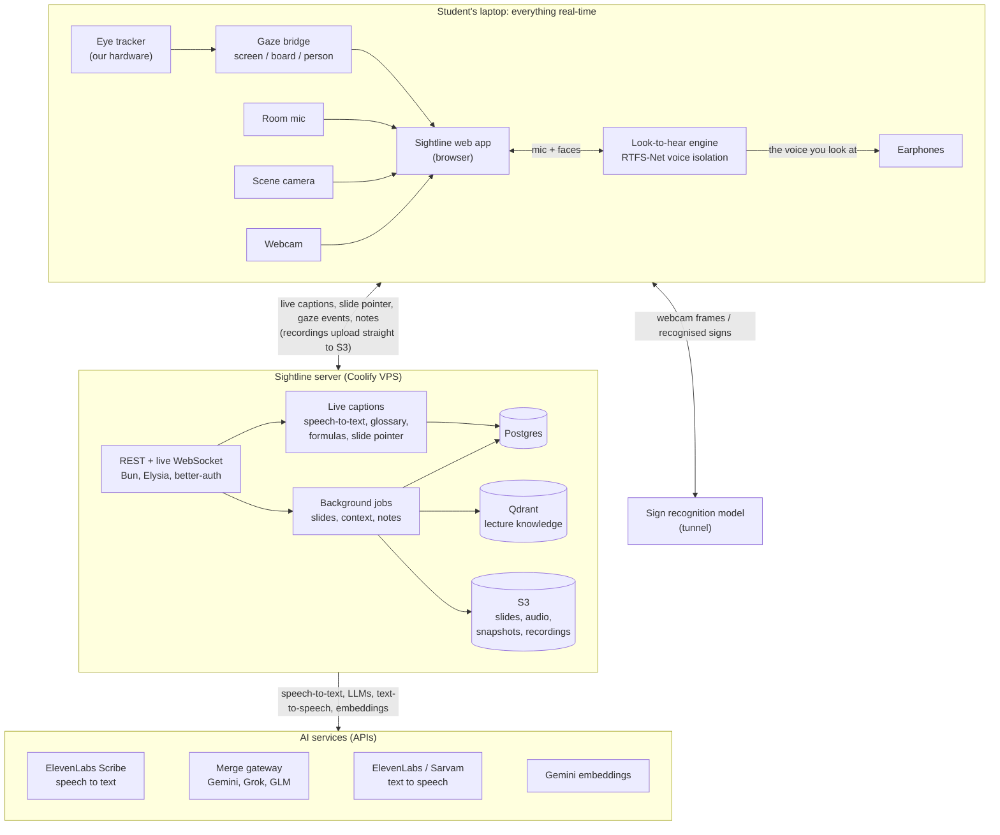
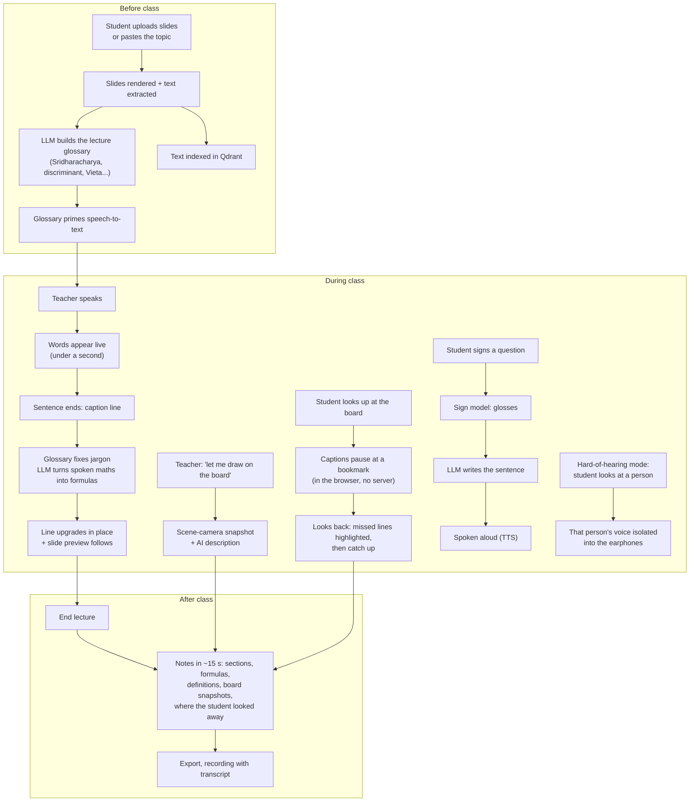

# Sightline: how it fits together

Paste either block into [mermaid.live](https://mermaid.live) (or view it on GitHub) to get the picture.

## 1. The system

Everything time-critical runs on the student's laptop; the server does captions, slides, notes and storage; AI is
called through APIs.

## 2. One lecture, start to finish

